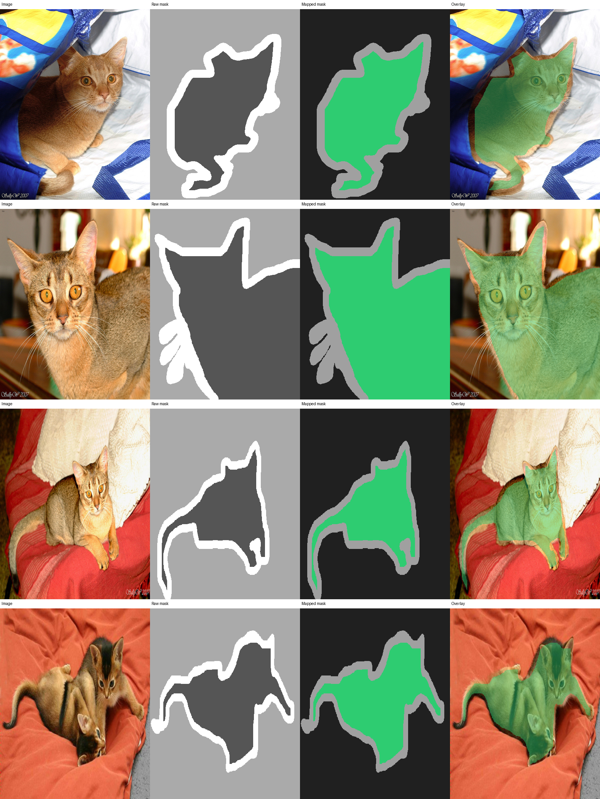
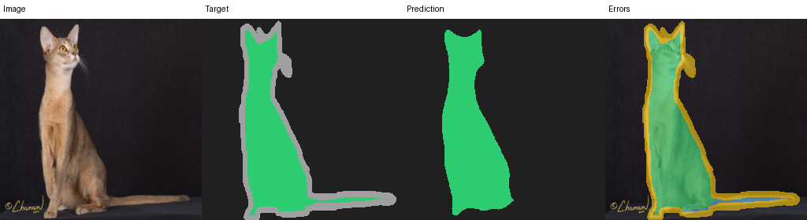
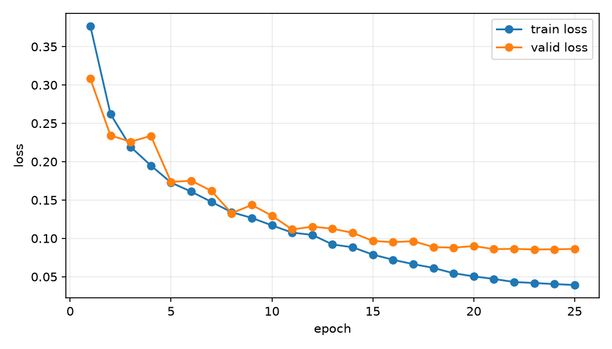

# PyTorch Image Segmentation Lab

[](LICENSE)
[](pyproject.toml)
[](.github/workflows/ci.yml)

**简体中文：[README.zh-CN.md](README.zh-CN.md)**

Learn semantic segmentation through a complete PyTorch project that turns pet
photos into pixel masks. The main path uses Oxford-IIIT Pet, a handwritten
U-Net, paired transforms, IoU/Dice evaluation, error overlays, and checkpoint-
only prediction.



## Who this is for

This lab is for learners who know basic Python, tensors, loss, and gradients but
have not completed an image segmentation project. You do not need to know U-Net
or read a paper first. The guided path takes roughly **8–12 hours**.

The current release teaches binary semantic segmentation: class 0 is background
and class 1 is pet. Instance segmentation, panoptic segmentation, and general
multi-class annotation formats remain outside this first learning path.

## First run

Follow one short workflow before reading every implementation detail:

```text
download -> fixed manifests -> inspect masks -> dry run -> train -> evaluate -> predict
```

Install Python 3.10–3.12, [uv](https://docs.astral.sh/uv/), and the locked
development environment:

```bash
git clone https://github.com/Doithoo/pytorch-image-segmentation-lab.git
cd pytorch-image-segmentation-lab
uv sync --extra dev
uv run segment --version
```

Download and verify Oxford-IIIT Pet. The official test split stays unchanged;
upstream trainval members are split 80/20 within each breed.

```bash
uv run python scripts/download_data.py --data-dir data/raw
uv run segment prepare-data --config configs/learning_minimal.yaml \
  --data-dir data/raw --manifest-dir data/manifests \
  --source-format oxford-pet
uv run python scripts/preview_dataset.py data/manifests/train.csv \
  --output artifacts/dataset_preview.png --limit 4
```

Open the preview before training. Oxford trimap values follow this mapping:

```text
1 -> pet
2 -> background
3 -> ignored/unclassified (training index 255)
```

Value 3 is excluded from loss and metrics. It is not a third prediction class.

## Check one batch

Run a real forward pass, loss, backward pass, and optimizer update:

```bash
uv run segment train --config configs/learning_minimal.yaml --dry-run
```

The output should end with `dry-run OK` and show image `[B,3,H,W]`, target
`[B,H,W]`, and logits `[B,2,H,W]` shapes. This proves the pipeline is connected;
it does not prove the model has learned useful masks.

Train the two-epoch learning configuration:

```bash
uv run segment train --config configs/learning_minimal.yaml \
  --set run_name first-unet
```

Inspect `artifacts/first-unet/config.yaml` and `metrics.csv` before changing any
settings. They record what ran and how validation pet IoU changed.

## Evaluate and predict

```bash
uv run segment evaluate --checkpoint artifacts/first-unet/best.pt \
  --split test --plot --device cpu
uv run segment predict --checkpoint artifacts/first-unet/best.pt \
  --image data/raw/images/Abyssinian_1.jpg \
  --output artifacts/predictions/Abyssinian_1.png --device cpu
```

Evaluation writes global and per-image metrics, representative overlays, and
worst cases. Prediction keeps the machine-readable 0/1 mask separate from color
and overlay images.



Pixel accuracy can hide a poor foreground mask when background dominates. The
project selects `best.pt` with validation pet IoU and reserves the official test
split for the final report.

## Measured reference run

A recorded 25-epoch U-Net run reached `0.902836` validation pet IoU and
`0.906669` pet IoU / `0.951050` pet Dice on all 3,669 official test images.
These values belong to the recorded manifest, configuration, revision, and
environment; they are not a universal U-Net benchmark.



The [reference report](docs/reference-run.md) preserves configuration, runtime
metadata, manifest hashes, metric tables, and failure examples. The current
repository tree does not keep the 89 MB checkpoint; reproduce it with the
published config and verify the recorded SHA-256 when sharing a release artifact.

## Continue learning

- Follow the [learning path](docs/learning-path.md) from tensor shapes to a controlled experiment.
- Use the [tutorial index](docs/tutorial/README.md) to choose the chapter that answers your current question.
- Trace one sample through the package with the [code tour](docs/code-tour.md).
- Read [how it works](docs/how-it-works.md) for labels, loss, metrics, and checkpoints.
- Compare CE/Dice, U-Net width, flips, and DeepLabV3 with the [experiment guide](docs/experiments.md).
- Diagnose setup, data, training, and inference failures with [troubleshooting](docs/troubleshooting.md).

## Use your own data

Generic data uses same-stem image and mask pairs:

```text
my-data/
|-- images/sample-001.jpg
`-- masks/sample-001.png
```

Read [using your data](docs/using-your-data.md) before training. It covers mask
values, label mapping, separate manifests, non-empty splits, and one-batch
validation. The built-in transform stretches both image and mask to a square;
aspect-ratio-sensitive domains may need padding or cropping instead.

## Configurations

- `configs/learning_minimal.yaml`: CPU-capable, 128 px, two epochs, bounded samples.
- `configs/reference_unet.yaml`: measured 25-epoch handwritten U-Net run.
- `configs/deeplabv3_resnet50.yaml`: advanced torchvision comparison; pretrained weights require network access.

Configuration precedence is:

```text
code defaults < YAML < --set overrides < dedicated CLI flags
```

```bash
uv run segment show-config --config configs/learning_minimal.yaml
uv run segment --help
```

## Repository map

```text
examples/                    five small programs to run and read first
configs/                     learning, reference, and model comparison settings
docs/                        learning path, tutorials, concepts, and experiments
scripts/                     download, preview, and plotting utilities
src/image_segmenter/         installed application and reusable package
tests/                       unit, integration, CLI, and end-to-end tests
data/manifests/              fixed membership and checksums
artifacts/                   local run outputs (not committed)
```

## Development

```bash
uv run ruff check .
uv run ruff format --check .
uv run pytest
uv build
uv run twine check dist/*
```

Tests use local synthetic fixtures and never download Oxford data or pretrained
weights. Read [CONTRIBUTING.md](CONTRIBUTING.md) before submitting changes.
Licensed under the [MIT License](LICENSE).
