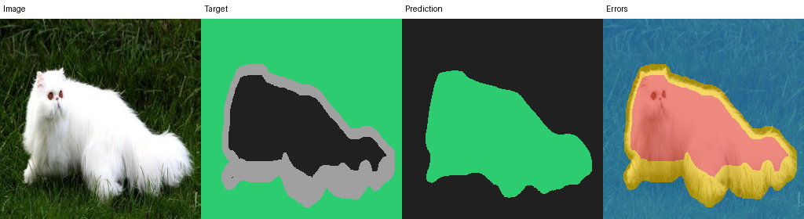

# Verified U-Net Reference Run

[简体中文](README.zh-CN.md) | [Back to documentation](../README.md)

This is an inspectable run, not a universal benchmark. Configuration,
membership, validation selection, test metrics, and visual failures belong to
one recorded experiment.

Oxford official test remained at 3,669 images; trainval became 2,941 train and
739 validation members within breed using seed 666. A base-32 U-Net trained on
256 px inputs for 25 epochs with equal CE/Dice weights and cosine scheduling.

The environment was macOS arm64/MPS, Python 3.11.15, PyTorch 2.13.0, and revision
`1deff1a03ba2d4549c538b4eef36df3868abe92b`. Training took 19,253 seconds and
resumed after an MPS memory interruption. The recorded revision did not persist
an independent DataLoader generator, so the run does not claim bit identity to
an uninterrupted process; a later fix addressed it.

Best epoch 24 reached `0.902836` validation pet IoU. Final test results were
`0.906669` global pet IoU, `0.951050` pet Dice, `0.928546` mean IoU, and
`0.966539` pixel accuracy. Mean per-image pet IoU was `0.905472`; seven targets
had no foreground.

Read the [resolved config](reference-unet-config.yaml),
[run metadata](reference-unet-run.yaml),
[training metrics](reference-unet-training-metrics.csv),
[evaluation JSON](reference-unet-evaluation.json),
[per-class table](reference-unet-per-class.csv), and
[per-image table](reference-unet-per-image.csv).




The current repository tree does not keep the 89 MB checkpoint. Its recorded
SHA-256 is
`5291b96d17df4c197e46ab5ff4f3d9b36b58b0aba63d334f314681bebc3f9e16`.
Distribute it as a release/model artifact with that hash, or reproduce it:

```bash
uv run python scripts/download_data.py --data-dir data/raw
uv run segment prepare-data --config configs/reference_unet.yaml \
  --data-dir data/raw --manifest-dir data/manifests \
  --source-format oxford-pet
uv run segment train --config configs/reference_unet.yaml
uv run segment evaluate --checkpoint artifacts/reference-unet/best.pt \
  --split test --plot
```

Compare manifest hashes, resolved config, environment, and trends. Small numeric
differences across hardware are expected; changed membership or protocol is a
different experiment.
